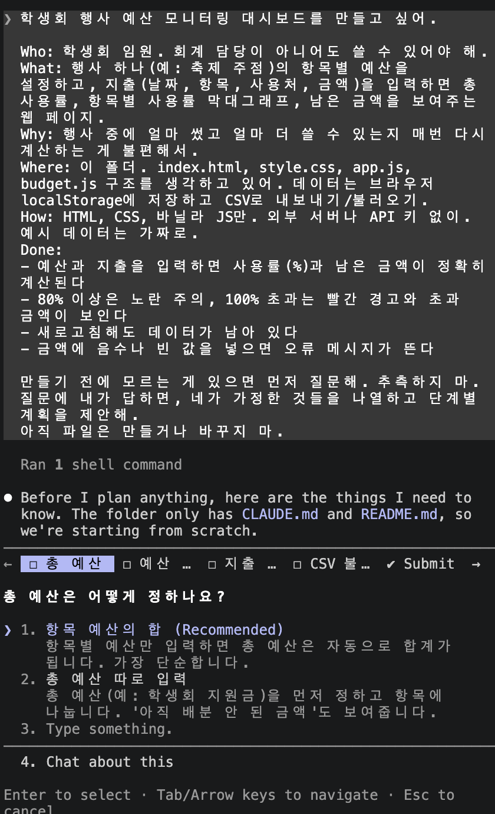
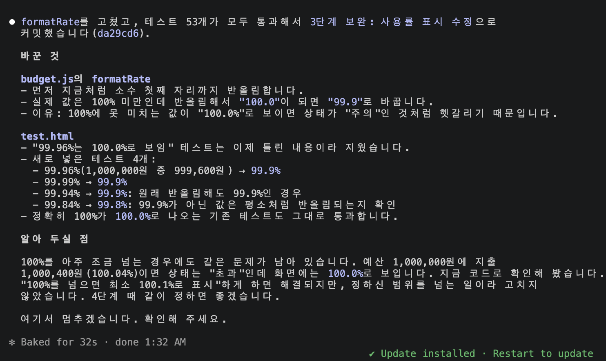
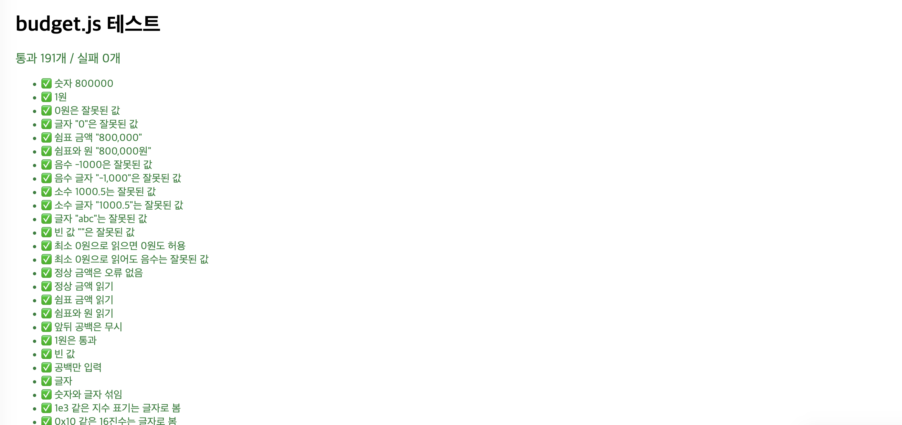
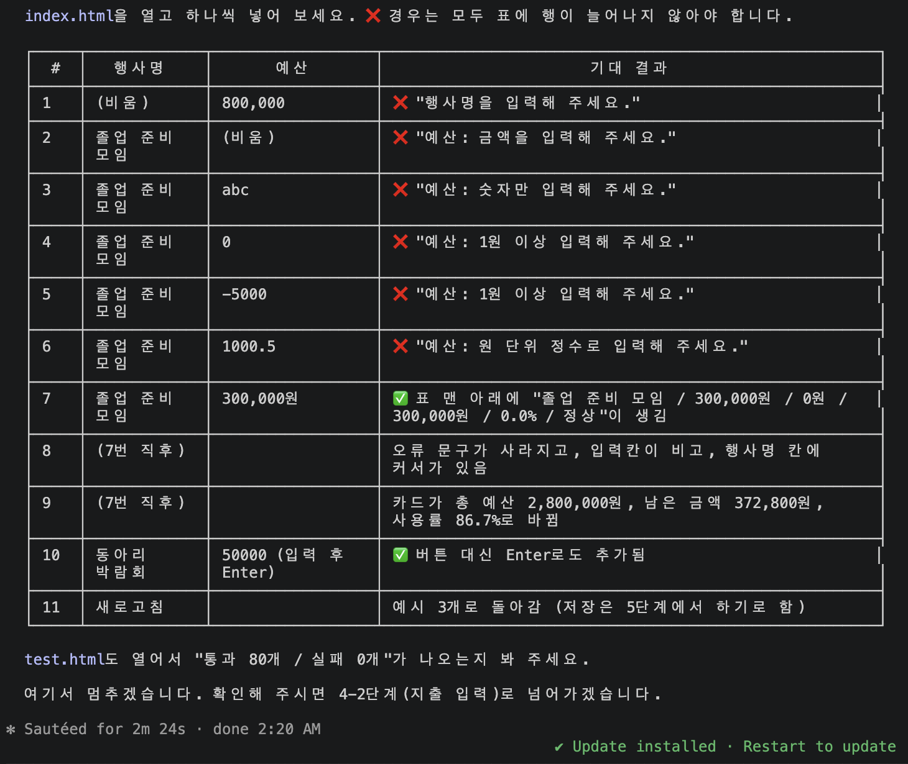
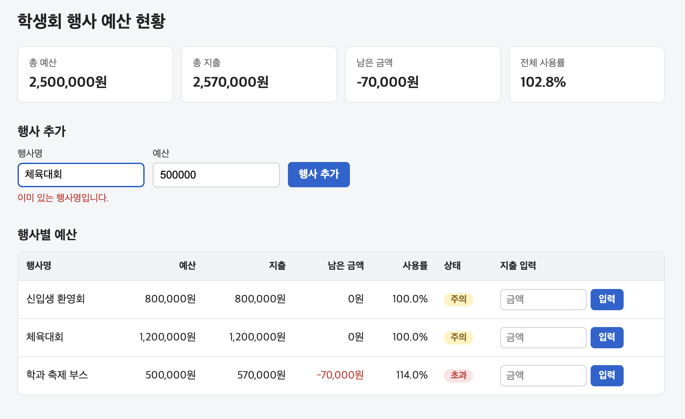
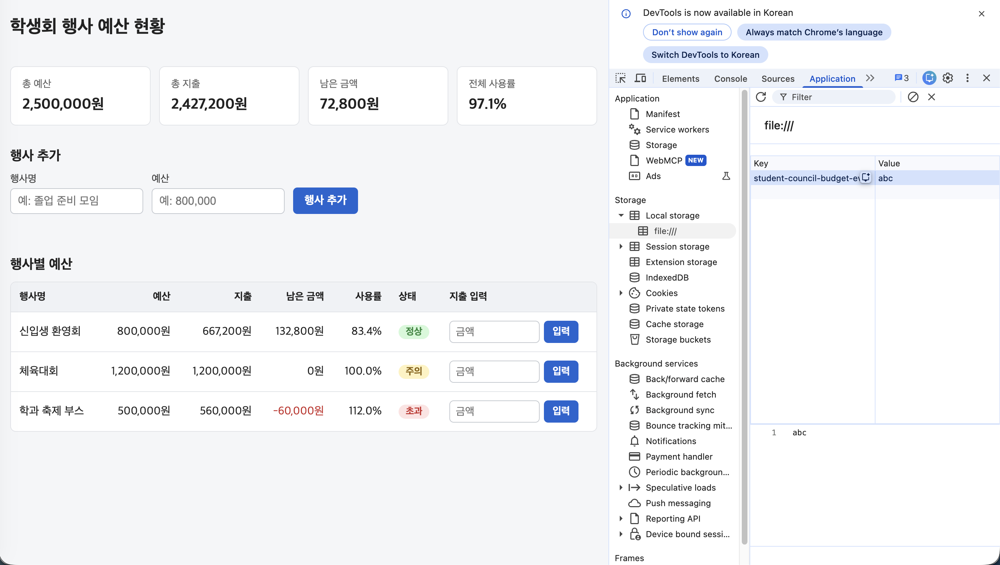

# student-council-budget
학생회 행사 예산 모니터링 대시보드

## 목적과 대상 사용자
- **대상**: 학생회 임원. 회계 담당이 아니어도 쓸 수 있습니다.
- **목적**: 행사별 예산과 지출을 넣으면 사용률, 남은 금액, 초과 여부를 바로 보여 줍니다.
- 설치나 가입 없이 `index.html`을 브라우저로 열기만 하면 됩니다.

## 쓰는 방법

### 열기
- `index.html`을 두 번 눌러 브라우저(Chrome, Safari 등)로 엽니다. 처음에는 가짜 예시 행사 3개가 보입니다.

### 화면 보기
- **위쪽 요약**: 큰 카드에 **전체 사용률**과 상태별 행사 개수, 작은 카드에 총 예산·총 지출·남은 금액이 보입니다.
- **행사별 표**: 행사마다 예산, 지출, 남은 금액, 사용률 막대, 상태를 보여 줍니다.
  - `✓ 정상`(초록): 지출 < 예산 / `! 주의`(노랑): 지출 = 예산 / `▲ 초과`(빨강): 지출 > 예산

### 행사 추가와 지출 입력
1. 행사명과 예산을 적고 **행사 추가**를 누릅니다. `800000`, `800,000`, `800,000원` 모두 됩니다.
2. 표의 "지출 입력" 칸에 금액을 적고 **입력**(또는 `Enter`)을 누릅니다. 지출은 기존 지출에 **더해집니다**.
- 잘못된 금액이나 이미 있는 행사명은 추가되지 않고 이유가 보입니다.
- 입력한 내용은 이 브라우저에 자동으로 저장됩니다.

### 내보내기
- **CSV로 내보내기**: 파일 이름을 묻는 창이 뜹니다(기본값 `학생회-예산-오늘날짜`). 엑셀, Numbers에서 열 수 있습니다.
- **구글 시트로 열기**: CSV를 받고 새 창에 빈 구글 시트를 엽니다. **파일 → 가져오기 → 업로드**로 받은 파일을 올립니다. 데이터는 구글로 자동으로 보내지 않습니다.

### 새로 시작하기와 지난 예산안
- 화면 맨 아래 **새로 시작하기**를 누르면 백업 CSV를 받은 뒤 행사를 모두 지웁니다. 백업 이름 창에서 **취소**하면 지우지 않습니다.
- 지운 예산안은 **지난 예산안 보기**에서 최근 10개까지 볼 수만 있습니다. 대시보드로 다시 불러올 수는 없습니다.

## 과정

최종 프로젝트를 만들기 전에, 내가 만들고자 하는 AI의 기능 중 하나를 먼저 구현해 보았다. 학생회 재정 운영 관리의 기초인 예산 관리 기능이다. 학생회는 투명하고 공정하며 근거 있는 학생회비 집행을 해야 한다. 예산을 적절하게 배분하고 책정해야 1년 동안의 행사 운영에 차질이 생기지 않기 때문에, 예산 관리 기능을 우선 만들었다.
내가 원하는 기능을 Claude Code에게 설명하며 프로젝트를 시작했고, 매 단계마다 계획 → 나의 확인 → 만들기 → 테스트 → 브라우저 확인 → 커밋을 반복했다.

1. 계산 함수를 만들었다. 예산안은 얼마를 썼고, 얼마가 남았고, 몇 %를 사용했는지 알아야 하므로 계산 함수가 꼭 필요했다.
2. index.html과 style.css로 화면 뼈대를 만들었다. 꾸준히 사용하려면 대시보드가 불편함 없이 깔끔해야 한다.
3. app.js로 행사 표와 요약 카드를 연결했다. 사용률 99.96%가 반올림되어 100.0%로 보이는 현상을 막기 위해 99.9%로 표시하도록 했다.
4. 금액 입력 검사, 행사 추가, 지출 누적 입력, 커서 유지, 같은 이름 막기 기능을 추가했다. 지출은 덮어쓰지 않고 누적으로 더한다. 예산안은 직접 입력해서 만들어야 하므로, 입력 부분이 정상적으로 작동하는지 확인하고 불편을 줄 수 있는 부분을 미리 막았다.
5. 자동 저장 기능을 만들었다. 브라우저를 새로고침해도 입력한 내용이 남고, 페이지를 열면 저장된 값을 불러온다.
6. CSV로 내보내는 기능을 추가했다. 대시보드에서만 보는 것은 의미가 적다고 판단해, CSV 파일로 내보내 원하는 곳에 활용할 수 있게 했다. 이후 전체 점검에서 Claude Code가 규칙에 어긋난 코드와 눈에 보이지 않는 글자(BOM) 문제를 찾아 고쳤다.
7. 대시보드의 가시성을 높이고 "구글 시트로 열기" 기능을 추가했다. 학생회 재정 파일은 보통 구글 시트로 관리하기 때문에 구글 시트를 바로 여는 버튼을 넣었다. 자동 연결은 API가 필요해서, 우선 구글 시트를 여는 기능까지만 만들었다.
8. CSV 파일 이름을 직접 정하는 기능과, 그동안 만든 예산안을 다시 볼 수 있는 "지난 예산안 보기" 기능을 추가했다.

## Claude Code 증거와 검증

### 테스트
- `test.html`의 `budget.js` 테스트 **191개 모두 통과** (통과 191개 / 실패 0개)

### 브라우저 확인
- Chrome에서 확인 목록 23개와 CSV(Numbers, 구글 시트)를 확인했습니다. Safari는 아직입니다.

### 엣지 케이스

| 입력 | 기대 | 결과 |
|---|---|---|
| 예산 1,000,000원, 지출 999,600원 | 반올림하면 100%지만 상태는 "정상", 사용률 `99.9%` | ✅ 통과 |
| 예산 800,000원, 지출 800,001원 | 1원만 넘어도 상태 "초과" | ✅ 통과 |
| 금액 `1e3` | "숫자만 입력해 주세요." | ✅ 통과 |
| 금액 `0` | "1원 이상 입력해 주세요." | ✅ 통과 |
| 행사명 `=1+1` (CSV) | 계산식이 되지 않게 `'=1+1`로 적힘 | ✅ 통과 |

### 스크린샷

**1. 만들기 전에 Claude Code가 먼저 질문 4개를 했습니다.**

**2. Claude Code가 99.96%→100.0% 표시 문제를 스스로 찾았습니다.**

**3. `test.html` 테스트 191개 모두 통과.**

**4. Claude Code가 만든 잘못된 입력 확인 목록 11개.**

**5. 같은 행사명은 막히고, 예산 초과는 빨간 "초과"로 표시.**

**6. 저장 데이터를 "abc"로 망가뜨려도 예시 데이터로 다시 시작.**

## 잘한 점

1. 계획 → 검수 → 만들기 → 테스트 → 커밋의 순서로 진행해 번거롭게 다시 고치는 횟수를 줄였다. 원하지 않는 기능이 생기거나 범위가 커지지 않는 효과도 있었다. 또한 무엇이 언제 바뀌었는지 기록이 남아서, 문제가 생겨도 어느 단계에서 생겼는지 찾기 쉬웠다.
2. PROGRESS.md를 이용해 다음 날에도 프로젝트를 이어 갔다. Claude Code를 새로 켜도 "PROGRESS.md 읽고 이어서 하자" 한 줄로 이어서 할 수 있어서, 여러 날에 걸쳐 작업해도 흐름이 끊기지 않았다. 나 또한 어디서부터 다시 시작해야 하는지 확인하기 편리했다.
3. 단계가 끝날 때마다 index.html을 직접 열어 확인했다. 저장 값을 바꾸거나 음수, 빈 값 등을 일부러 잘못 입력해 보며 오작동하거나 데이터가 사라지지 않는지 확인했다. 직접 확인했기 때문에 AI가 잘못 판단한 채로 넘어가는 문제가 없었다.

## 어려운 점

1. 반올림 때문에 헷갈리는 문제가 있었다. 99.96%가 100.0%로 반올림되어 다 쓴 것처럼 보이거나, 100.04%가 100.0%로 보여 초과가 드러나지 않았다. Claude Code가 직접 이 문제를 찾았고, 100% 근처는 99.9% 또는 100.1%로 나타내도록 규칙을 바꿨다. 숫자가 맞는 것과 보이는 것은 다를 수 있다는 것을 알게 되었다.
2. 원했던 기능은 버튼 하나로 구글 시트에 바로 연결되는 것이었다. 하지만 API 키가 필요해서 대안이 필요했고, CSV를 받은 뒤 새 시트를 열어 직접 가져오는 방식으로 타협했다. 원했던 기능을 만들지 못해 아쉬웠고, 최종 프로젝트에서는 만들 수 있도록 노력할 것이다. 이 부분은 한계점으로 이어진다.
3. 잘못 넣은 지출을 고칠 수 없었다. 지출을 누적으로 더하게 했더니 되돌릴 방법이 없었다. 1 이상의 정수만 받게 해서 실수를 줄였지만, 지출을 되돌리지 못하면 새 예산안을 만들어야 하는 한계가 남았다.

## 한계점

1. 사용하는 브라우저에만 저장된다. 다른 컴퓨터나 다른 브라우저에서 열면 작업하던 기록이 보이지 않는다. 서버 없이 만들기로 결정했기 때문이다. 그래서 임원끼리 공유하려면 CSV로 내보내 따로 주고받는 방법밖에 없다.
2. 잘못 넣은 지출을 되돌리거나 행사를 지울 수 없다. 지금은 "새로 시작하기"로 전체를 지워야 한다. 최종 프로젝트까지 대안을 마련해 기능을 추가할 것이다.
3. 구글 시트에서 CSV 파일을 직접 가져와야 한다. 어려운 점에서 말한 것처럼 가장 아쉬운 부분이다. 구글 시트에 바로 연결하고 싶었지만 API 키가 필요해 이번에는 만들지 못했다.
4. 확인한 범위가 좁다. Mac의 Chrome에서만 확인했고, Windows나 Safari에서는 실행해 보지 않았다. 다른 브라우저나 기기에서 어떻게 작동하는지 아직 검증이 필요하다.

## 핵심 파일 5개
- `budget.js`: 사용률, 남은 금액, 초과 판단 등 모든 계산과 입력 규칙
- `app.js`: 화면을 채우고 버튼과 입력칸이 동작하게 함 (계산은 `budget.js`에 맡김)
- `index.html`: 화면 구조. 브라우저로 이 파일을 엽니다
- `style.css`: 색, 간격, 막대 등 화면 모양
- `test.html`: `budget.js` 테스트 191개를 브라우저에서 실행
